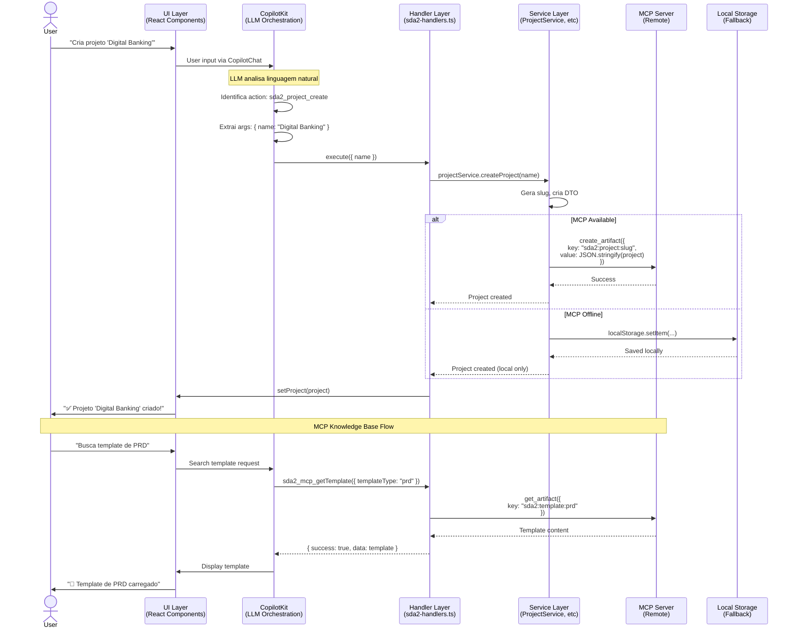
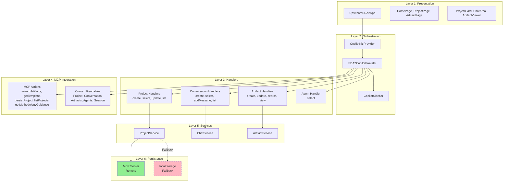

# Implementação CopilotKit no Upstream-SDA-2

## 📋 Visão Geral

Este documento explica a arquitetura e implementação da integração **CopilotKit** no **Upstream-SDA-2**, transformando o sistema em uma plataforma moderna com IA conversacional, orquestração inteligente e persistência via MCP.

---

## 🎯 Contexto e Motivação

### O Desafio

O Upstream-SDA-2 é uma evolução da plataforma SDA com foco em:

- **Gestão de projetos** com múltiplos artifacts
- **Conversas especializadas** com diferentes agentes (PM, Architect, PO, UX, Analyst)
- **Artifacts complexos** (PRD, Architecture, Epics, etc)
- **Persistência hierárquica** via MCP (Project → Chat → Documents)

### A Solução

Implementamos uma arquitetura **CopilotKit + MCP** seguindo o padrão do Upstream-SDA original, adaptada para o novo modelo de dados:

```
User Input → CopilotKit LLM → Handler Actions → Services → MCP (com fallback localStorage)
```

**Benefícios:**

- ✅ IA conversacional real processando linguagem natural
- ✅ 14 handlers organizados por categoria (Project, Conversation, Artifact, Agent)
- ✅ 5 MCP actions para knowledge base e persistência
- ✅ Context readables fornecendo estado completo ao LLM
- ✅ Fallback inteligente quando MCP offline
- ✅ Integração com Cockpit via services

---

## 📊 Arquitetura em Camadas

### 1. Fluxo Completo de Dados



### 2. Arquitetura em Camadas



---

## 🏗️ Estrutura de Arquivos

```
upstream-sda-2/
├── copilot/                              # CopilotKit integration
│   ├── types.ts                          # TypeScript types
│   ├── sda2-handlers.ts                  # 14 action handlers
│   ├── sda2-mcp-integration.tsx          # 5 MCP actions
│   ├── sda2-context-readables.tsx        # Context readables
│   ├── sda2-copilot-provider.tsx         # Main provider
│   └── index.ts                          # Exports
│
├── index.tsx                             # Main app with CopilotKit wrapper
│
├── components/
│   ├── chat/                             # Chat components
│   ├── projects/                         # Project components
│   └── artifacts/                        # Artifact components
│
├── hooks/
│   ├── useCockpitServices.ts             # Services hook
│   └── useSupervisorChat.ts              # Supervisor chat hook
│
├── pages/
│   ├── HomePage.tsx                      # Home page
│   ├── ProjectPage.tsx                   # Project page
│   └── ArtifactPage.tsx                  # Artifact page
│
├── services/
│   ├── project.service.ts                # Project CRUD
│   ├── chat.service.ts                   # Chat management
│   └── artifact.service.ts               # Artifact detection
│
├── stores/
│   └── projectStore.ts                   # Zustand store
│
└── types/
    └── index.ts                          # Type definitions
```

---

## 🔧 Componentes Principais

### 1. `sda2-handlers.ts` - Action Handlers

**Propósito:** Define 14 handlers organizados por categoria.

**Categorias:**

1. **Project Handlers** (4): create, select, update, list
2. **Conversation Handlers** (4): create, select, addMessage, list
3. **Artifact Handlers** (4): create, update, search, view
4. **Agent Handler** (1): select
5. **MCP Placeholders** (5): Referências para MCP actions

**Pattern de Persistência:**

```typescript
async function persistToMCP(ctx, key, data): Promise<PersistenceResult> {
  if (ctx.mcpReady) {
    await ctx.callMCPTool('create_artifact', {
      key,
      value: JSON.stringify(data),
    })
    return { success: true, persisted: true }
  } else {
    localStorage.setItem(key, JSON.stringify(data))
    return { success: true, persisted: false, localOnly: true }
  }
}
```

**Exemplo de Handler:**

```typescript
const project_create: ActionHandler = {
  name: 'sda2_project_create',
  description: 'Create a new SDA2 project with name and optional description',
  parameters: [
    { name: 'name', type: 'string', required: true },
    { name: 'description', type: 'string', required: false },
  ],
  execute: async ({ name, description }) => {
    const project = await ctx.projectService.createProject(name, description)
    await persistToMCP(ctx, `sda2:project:${project.id}`, project)
    ctx.setProject(project)
    return `✅ Project "${project.name}" created successfully!`
  },
}
```

---

### 2. `sda2-mcp-integration.tsx` - MCP Actions

**Propósito:** Provê 5 ações para interagir com MCP Server e knowledge base.

**Actions:**

#### 🔍 `sda2_mcp_searchArtifacts`

Busca artifacts no MCP por termo e tipo.

```typescript
useCopilotAction({
  name: 'sda2_mcp_searchArtifacts',
  description: 'Search for artifacts in MCP knowledge base',
  parameters: [
    { name: 'searchTerm', type: 'string', required: true },
    { name: 'artifactType', type: 'string', required: false },
  ],
  handler: async ({ searchTerm, artifactType }) => {
    const result = await callMCPTool('search_artifacts', {
      query: searchTerm,
      artifact_type_name: artifactType,
      tags: 'sda2',
    })
    return { success: true, data: result }
  },
})
```

#### 📄 `sda2_mcp_getTemplate`

Recupera template por tipo (prd, architecture, etc).

#### 💾 `sda2_mcp_persistProject`

Persiste projeto no MCP com fallback localStorage.

#### 📋 `sda2_mcp_listProjects`

Lista todos os projetos SDA2 do MCP.

#### 🧠 `sda2_mcp_getMethodologyGuidance`

Busca orientações da Avanade Method no knowledge base.

---

### 3. `sda2-context-readables.tsx` - Context Readables

**Propósito:** Fornece 6 contextos ao LLM via `useCopilotReadable`.

**Readables:**

1. **Current Project** - Informações do projeto atual
2. **Current Conversation** - Conversa e mensagens
3. **Available Artifacts** - Lista de artifacts com preview
4. **Available Agents** - Agentes Avanade com expertise
5. **Artifact Types** - Tipos de artifacts que podem ser criados
6. **Current Session State** - Estado da navegação e ações sugeridas

**Exemplo:**

```typescript
useCopilotReadable({
  description: 'Current SDA2 project with basic information',
  value: project
    ? {
        id: project.id,
        name: project.name,
        conversationsCount: project.conversations?.length || 0,
        artifactsCount: project.artifacts?.length || 0,
      }
    : null,
})
```

**Suggested Actions (contextuais):**

- Sem projeto → "Create a new project", "List existing projects"
- Com projeto, sem conversa → "Start a new conversation", "Select an agent"
- Com conversa → "Create an artifact", "Search for templates"

---

### 4. `sda2-copilot-provider.tsx` - Main Provider

**Propósito:** Provider principal que registra todos os handlers e MCP actions.

**Responsabilidades:**

1. Gerenciar estado MCP (ready, tools)
2. Criar handler context com services
3. Registrar todos os 14 handlers como `useCopilotAction`
4. Registrar context readables
5. Renderizar MCP integration component

**Estrutura:**

```typescript
export function SDA2CopilotProvider({
  project,
  currentConversation,
  artifacts,
  setProject,
  setCurrentConversation,
  setArtifacts,
  connection,
  projectService,
  chatService,
  artifactService,
}: SDA2CopilotProviderProps) {

  // MCP connection state
  const [mcpReady, setMcpReady] = useState(false)

  // Handler context
  const handlerContext = useMemo(() => ({
    project,
    currentConversation,
    artifacts,
    setProject,
    setCurrentConversation,
    setArtifacts,
    mcpReady,
    callMCPTool,
    projectService,
    chatService,
    artifactService,
  }), [...deps])

  // Create handlers
  const handlers = useMemo(() => createSDA2Handlers(handlerContext), [handlerContext])

  // Register all handlers
  useCopilotAction({ name: handlers.project_create.name, ... })
  useCopilotAction({ name: handlers.project_select.name, ... })
  // ... 12 more handlers

  // Register readables
  useSDA2ContextReadables({ project, currentConversation, artifacts })

  // Render MCP integration
  return (
    <>
      <SDA2MCPIntegration mcpReady={mcpReady} callMCPTool={callMCPTool} />
      {children}
    </>
  )
}
```

---

### 5. `index.tsx` - Main App Integration

**Propósito:** Integra CopilotKit no app principal.

**Estrutura:**

```typescript
export function UpstreamSDA2App() {
  const { currentProject, currentConversation, ... } = useProjectStore()
  const services = useCockpitServices()
  const artifacts = useMemo(() => currentProject?.artifacts || [], [currentProject])

  return (
    <CopilotKit runtimeUrl="/api/copilotkit">
      <SDA2CopilotProvider
        project={currentProject}
        currentConversation={currentConversation}
        artifacts={artifacts}
        setProject={setCurrentProject}
        setCurrentConversation={setCurrentConversation}
        setArtifacts={(newArtifacts) => {
          setCurrentProject({ ...currentProject, artifacts: newArtifacts })
        }}
        projectService={services.projectService}
        chatService={services.chatService}
        artifactService={services.artifactService}
      >
        <CopilotSidebar
          defaultOpen={false}
          labels={{
            title: 'Avanade AI Assistant',
            initial: 'Como posso ajudar com seu projeto SDA?',
          }}
        >
          {renderContent()}
        </CopilotSidebar>
      </SDA2CopilotProvider>
    </CopilotKit>
  )
}
```

---

## 🔄 Fluxos de Trabalho

### Fluxo 1: Criar Novo Projeto

```
1. USER: "Cria um projeto chamado 'Mobile App Modernization'"

2. COPILOTKIT:
   - Analisa input
   - Identifica: sda2_project_create
   - Args: { name: "Mobile App Modernization" }

3. HANDLER:
   projectService.createProject("Mobile App Modernization")
   → Gera slug: "mobile-app-modernization"
   → Cria projeto no MCP ou localStorage
   → setProject(project)

4. ASSISTANT:
   "✅ Projeto 'Mobile App Modernization' criado com sucesso! ID: mobile-app-modernization"
```

### Fluxo 2: Iniciar Conversa com Agente

```
1. USER: "Quero conversar com a Maria sobre requisitos"

2. COPILOTKIT:
   - Identifica: sda2_conversation_create
   - Args: { title: "Requisitos", agentType: "analyst" }

3. HANDLER:
   chatService.createConversation(projectId, "Requisitos", "analyst")
   → Cria conversa com agente "Maria - Business Analyst"
   → Persiste no MCP
   → setCurrentConversation(conversation)

4. ASSISTANT:
   "✅ Conversa 'Requisitos' criada com Maria - Business Analyst!"
```

### Fluxo 3: Criar Artifact (PRD)

```
1. USER: "Gera um PRD greenfield para o projeto"

2. COPILOTKIT:
   - Identifica: sda2_artifact_create
   - Args: { title: "PRD - Mobile App", type: "prd-greenfield", content: "..." }

3. HANDLER:
   artifactService.createArtifact({ ... })
   → Cria artifact
   → Persiste no MCP: "sda2:artifact:{id}"
   → Adiciona ao projeto

4. ASSISTANT:
   "✅ Artifact 'PRD - Mobile App' criado com sucesso!"
```

### Fluxo 4: Buscar Template

```
1. USER: "Me mostra o template de arquitetura"

2. COPILOTKIT:
   - Identifica: sda2_mcp_getTemplate
   - Args: { templateType: "architecture" }

3. MCP ACTION:
   callMCPTool('get_artifact', { key: "sda2:template:architecture" })
   → Retorna template

4. ASSISTANT:
   "📄 Template de Architecture Document:

   ## System Architecture
   ...

   Quer que eu preencha baseado no seu projeto?"
```

---

## 📊 Handlers Disponíveis

### Project Handlers

| Handler               | Descrição         | Parâmetros         |
| --------------------- | ----------------- | ------------------ |
| `sda2_project_create` | Cria novo projeto | name, description? |
| `sda2_project_select` | Seleciona projeto | identifier         |
| `sda2_project_update` | Atualiza projeto  | updates            |
| `sda2_project_list`   | Lista projetos    | -                  |

### Conversation Handlers

| Handler                        | Descrição          | Parâmetros       |
| ------------------------------ | ------------------ | ---------------- |
| `sda2_conversation_create`     | Cria conversa      | title, agentType |
| `sda2_conversation_select`     | Seleciona conversa | conversationId   |
| `sda2_conversation_addMessage` | Adiciona mensagem  | content, role    |
| `sda2_conversation_list`       | Lista conversas    | -                |

### Artifact Handlers

| Handler                | Descrição          | Parâmetros           |
| ---------------------- | ------------------ | -------------------- |
| `sda2_artifact_create` | Cria artifact      | title, type, content |
| `sda2_artifact_update` | Atualiza artifact  | artifactId, updates  |
| `sda2_artifact_search` | Busca artifacts    | query, type?         |
| `sda2_artifact_view`   | Visualiza artifact | artifactId           |

### Agent Handler

| Handler             | Descrição        | Parâmetros |
| ------------------- | ---------------- | ---------- |
| `sda2_agent_select` | Seleciona agente | agentType  |

### MCP Actions

| Action                            | Descrição          | Parâmetros                |
| --------------------------------- | ------------------ | ------------------------- |
| `sda2_mcp_searchArtifacts`        | Busca no MCP       | searchTerm, artifactType? |
| `sda2_mcp_getTemplate`            | Recupera template  | templateType              |
| `sda2_mcp_persistProject`         | Persiste projeto   | project                   |
| `sda2_mcp_listProjects`           | Lista projetos MCP | -                         |
| `sda2_mcp_getMethodologyGuidance` | Busca orientações  | topic                     |

---

## 🚀 Como Usar

### Exemplos de Conversação

#### 1. Criar Projeto

```
User: "Cria um projeto para redesenhar nosso portal interno"
Assistant: "✅ Projeto 'Portal Interno Redesign' criado! Quer iniciar uma conversa com algum agente?"

User: "Sim, com o Wilson sobre arquitetura"
Assistant: "✅ Conversa criada com Wilson - Software Architect!"
```

#### 2. Gerar Artifacts

```
User: "Gera um PRD greenfield"
Assistant: "✅ PRD criado! Baseei na descrição do projeto. Quer que eu refine alguma seção?"

User: "Detalha mais os requisitos não-funcionais"
Assistant: "✅ Seção de requisitos não-funcionais expandida com:
- Performance: < 2s page load
- Segurança: OAuth 2.0 + RBAC
- Escalabilidade: Suporte a 10k usuários simultâneos
..."
```

#### 3. Buscar Templates e Guidance

```
User: "Preciso de orientação sobre como escrever epics"
Assistant: "🧠 Encontrei guidance da Avanade Method sobre Epic Writing:

## Epic Structure
- Epic Title: [Role] can [action]
- Business Value: Why this matters
- User Stories: Breakdown into 5-8 stories
...

Quer que eu crie epics para o seu projeto?"
```

---

## 🧪 Testes

### Cenários de Teste

1. **Criar projeto** → Verificar persistência MCP/localStorage
2. **Selecionar agente** → Verificar mudança de contexto
3. **Criar artifacts** → Verificar geração e persistência
4. **Buscar templates** → Verificar conexão MCP
5. **Fallback offline** → Desconectar MCP e verificar localStorage

### Comandos de Teste

```bash
# Iniciar app
pnpm run dev

# Abrir sidebar Copilot
# Testar comandos:
"cria projeto teste"
"lista projetos"
"inicia chat com maria"
"gera prd greenfield"
"busca template de arquitetura"
```

---

## 📈 Comparação: SDA vs SDA-2

| Aspecto                | Upstream-SDA               | Upstream-SDA-2            |
| ---------------------- | -------------------------- | ------------------------- |
| **Foco**               | SDA Initiatives (4 stages) | Multi-project management  |
| **Entidade Principal** | Initiative                 | Project                   |
| **Conversas**          | Single thread              | Multiple per project      |
| **Agents**             | Cross-cutting              | Per conversation          |
| **Artifacts**          | Tied to initiative         | Tied to project/chat      |
| **Handlers**           | 18 (por stage)             | 14 (por categoria)        |
| **MCP Actions**        | 5 (mesmo padrão)           | 5 (adaptado)              |
| **Persistência**       | Initiative-centric         | Project-centric hierarchy |
| **Services**           | Direct MCP calls           | Service layer abstraction |

---

## 🎯 Próximos Passos

### Curto Prazo

- [ ] Implementar mock services para desenvolvimento offline
- [ ] Adicionar validações nos handlers
- [ ] Criar testes unitários para handlers
- [ ] Melhorar error handling e feedback

### Médio Prazo

- [ ] Integrar com MCP Server real (substituir mock)
- [ ] Implementar sincronização bidirecional com Cockpit
- [ ] Adicionar canvas de visualização de projeto
- [ ] Expandir knowledge base com mais templates

### Longo Prazo

- [ ] Multi-tenancy via MCP namespaces
- [ ] Analytics de uso de handlers
- [ ] Fine-tuning de prompts
- [ ] Integração com Azure DevOps

---

## 📚 Referências

### Documentação Interna

- [Upstream-SDA CopilotKit Implementation](../upstream-sda/docs/COPILOTKIT-IMPLEMENTATION.md)
- [Upstream CopilotKit Implementation](../upstream/docs/COPILOTKIT-IMPLEMENTATION.md)
- [MCP Integration Guide](../../shared/docs/MCP-INTEGRATION.md)

### Documentação Externa

- [CopilotKit Documentation](https://docs.copilotkit.ai)
- [Model Context Protocol](https://spec.modelcontextprotocol.io)

---

## 👥 Manutenção

**Implementado por:** Tiago Costa - Developer  
**Data:** Janeiro 2026  
**Versão:** 1.0.0

---

**🎉 Fim da Documentação**

Esta implementação estabelece o Upstream-SDA-2 como uma plataforma moderna com IA conversacional, orquestração inteligente e persistência robusta, seguindo os padrões estabelecidos pelo Upstream-SDA original e adaptados ao novo modelo de gestão de projetos.
