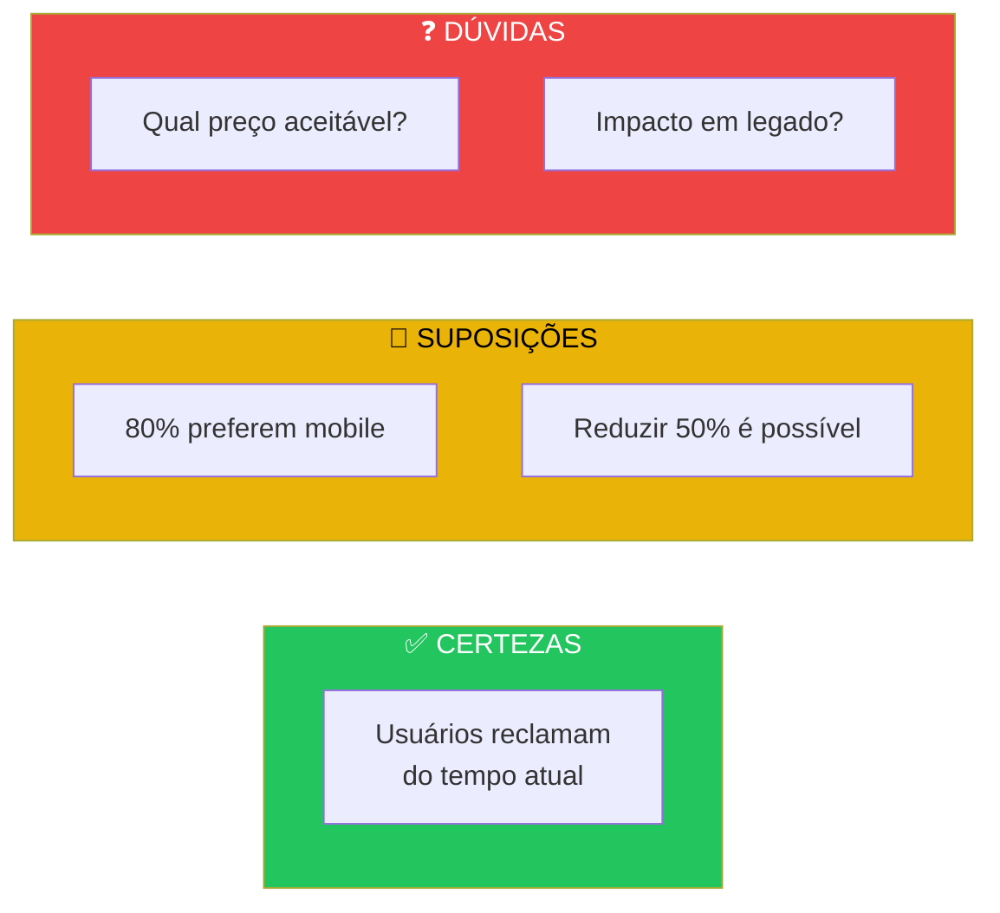
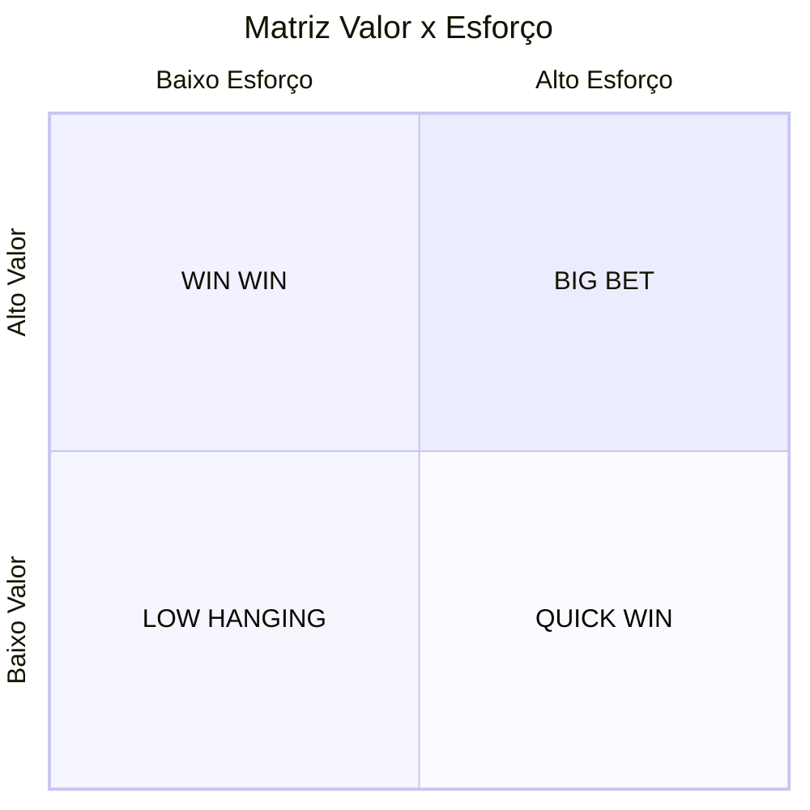
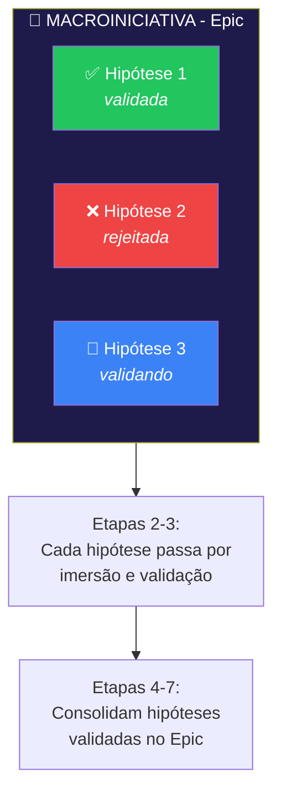

# BV Framework - 7 Etapas

## Visão Geral

O **BV Framework** (Business Value Framework) é a metodologia que guia a descoberta e validação de iniciativas de negócio no Cockpit Portal. São 7 etapas estruturadas que garantem que ideias sejam validadas antes de ir para desenvolvimento.

## As 7 Etapas

```mermaid
flowchart TB
    subgraph BV["🎯 BV FRAMEWORK - 7 ETAPAS"]
        E1["<b>ETAPA 1: IDEAÇÃO</b><br/>Nome, OKRs, Problema, Alinhamento<br/><i>[Epic-level]</i>"]
        E2["<b>ETAPA 2: IMERSÃO</b><br/>Matriz CSD, Stakeholders, Oportunidades<br/><i>[Por Hipótese] 🔁</i>"]
        E3["<b>ETAPA 3: VALIDAÇÃO</b><br/>Método, Evidências, Conclusão<br/><i>[Por Hipótese] 🔁</i>"]
        E4["<b>ETAPA 4: EXPLORAÇÃO</b><br/>Requisitos, Fluxos, Jornadas, Atores<br/><i>[Epic-level]</i>"]
        E5["<b>ETAPA 5: ANÁLISE</b><br/>Blueprint, Impacto, Gap, Dependências<br/><i>[Epic-level]</i>"]
        E6["<b>ETAPA 6: PRIORIZAÇÃO</b><br/>Valor, Esforço, Risco, KPIs, QBR<br/><i>[Epic-level]</i>"]
        E7["<b>ETAPA 7: TRANSIÇÃO</b><br/>Business Epics, Features, Handoff, Jira<br/><i>[Epic-level]</i>"]

        E1 --> E2 --> E3 --> E4 --> E5 --> E6 --> E7
    end

    style E1 fill:#4f46e5,color:#fff
    style E2 fill:#0891b2,color:#fff
    style E3 fill:#0891b2,color:#fff
    style E4 fill:#059669,color:#fff
    style E5 fill:#059669,color:#fff
    style E6 fill:#d97706,color:#fff
    style E7 fill:#dc2626,color:#fff
```



## Etapa 1: Ideação

**Objetivo**: Definir a macroiniciativa e seu alinhamento estratégico.

### O que preencher:

| Campo         | Descrição                      |
| ------------- | ------------------------------ |
| Nome          | Nome da macroiniciativa        |
| OKRs          | OKRs estratégicos relacionados |
| Problema      | Declaração clara do problema   |
| Alinhamento   | Justificativa estratégica      |
| Valor Inicial | Slider 0-100                   |

### Resultado:

- Epic criado com contexto inicial
- Base para criação de hipóteses

---

## Etapa 2: Imersão (Por Hipótese)

**Objetivo**: Explorar profundamente cada hipótese de negócio.

> ⚠️ **Esta etapa é executada PARA CADA HIPÓTESE**

### O que preencher:

| Campo           | Descrição                     |
| --------------- | ----------------------------- |
| Statement       | "Acreditamos que..."          |
| Matriz CSD      | Certezas, Suposições, Dúvidas |
| Stakeholders    | Partes interessadas           |
| Oportunidades   | Árvore de oportunidades       |
| Fontes de Dados | Onde validar                  |

### Exemplo de Matriz CSD:



---

## Etapa 3: Validação (Por Hipótese)

**Objetivo**: Validar hipóteses com evidências concretas.

> ⚠️ **Esta etapa é executada PARA CADA HIPÓTESE**

### Métodos de Validação:

- Entrevistas com usuários
- A/B Testing
- Protótipos
- Análise de dados
- Surveys
- Experimentos

### Tipos de Evidência:

| Tipo         | Exemplos                           |
| ------------ | ---------------------------------- |
| Qualitativa  | Entrevistas, feedback, observações |
| Quantitativa | Métricas, números, percentuais     |
| Documentos   | Relatórios, estudos, pesquisas     |

### Níveis de Evidência:

```
none → weak → medium → strong
```

### Conclusões Possíveis:

- ✅ **Validada**: Evidências fortes confirmam
- ❌ **Rejeitada**: Evidências refutam
- 🔄 **Precisa mais dados**: Insuficiente
- 🔀 **Pivot**: Mudar direção

---

## Etapa 4: Exploração

**Objetivo**: Desenhar a solução consolidada pós-validação.

### O que preencher:

| Campo                | Descrição                    |
| -------------------- | ---------------------------- |
| Macro Requisitos     | Requisitos de alto nível     |
| Atores               | Internos, externos, sistemas |
| Fluxo de Negócio     | Diagrama Mermaid ou URL      |
| Jornada do Usuário   | Mapa da experiência          |
| Teste de Usabilidade | Resultados e issues          |

### Tipos de Atores:

- **Interno**: Funcionários, equipes
- **Externo**: Clientes, parceiros
- **Sistema**: Integrações, APIs

---

## Etapa 5: Análise

**Objetivo**: Análise técnica e de impacto.

### O que preencher:

| Campo              | Descrição                     |
| ------------------ | ----------------------------- |
| Blueprint          | Arquitetura da solução        |
| Análise de Impacto | Sistemas e processos afetados |
| Análise de Gap     | Diferença atual vs. desejado  |
| Dependências       | Técnicas e de negócio         |
| Mitigações         | Planos para riscos            |

---

## Etapa 6: Priorização

**Objetivo**: Preparar para QBR e priorizar.

### O que preencher:

| Campo       | Descrição                   |
| ----------- | --------------------------- |
| Valor Final | Slider 0-100 refinado       |
| Esforço     | Slider 0-100                |
| Risco       | Low, Medium, High, Critical |
| KPIs        | Indicadores de sucesso      |
| Memo QBR    | Resumo executivo            |
| Aderência   | Score de alinhamento        |

### Matriz Valor x Esforço:



---

## Etapa 7: Transição

**Objetivo**: Transicionar para Downstream (desenvolvimento).

### O que criar:

| Item           | Descrição               |
| -------------- | ----------------------- |
| Business Epics | 1 Macro → N BEs         |
| Features       | Com MoSCoW priority     |
| Handoff        | Documento markdown      |
| Link Jira      | URL do backlog          |
| Acordos        | Responsabilidades N1/N2 |

### Priorização MoSCoW:

- **Must**: Obrigatório para MVP
- **Should**: Importante, não crítico
- **Could**: Desejável se houver tempo
- **Won't**: Fora do escopo atual

---

## Conceito: Epic vs Hipótese



## Próximos Passos

1. [Usando o Wizard](./03-wizard.md)
2. [Assistente IA (Copilot)](./04-copilot.md)
