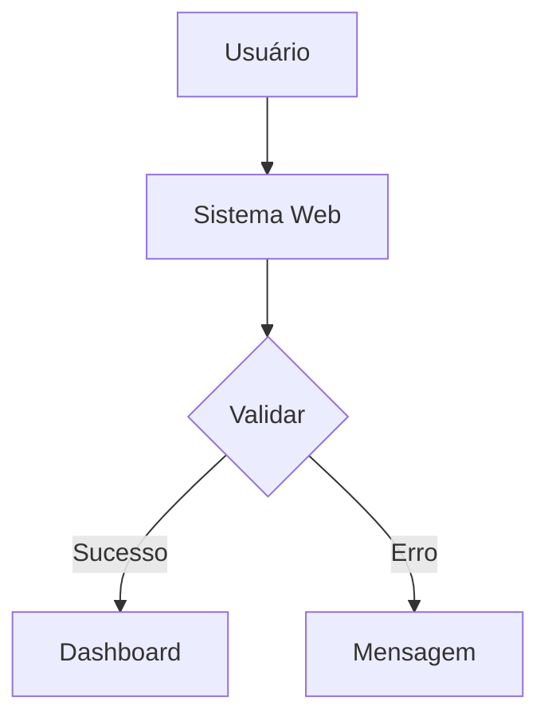

# Usando o Wizard de Criação

## Visão Geral

O Wizard é a interface principal para criar e editar macroiniciativas no Upstream. Ele guia você pelas 7 etapas do BV Framework com interface intuitiva e assistência de IA.

## Acessando o Wizard

```
Dashboard Upstream
       ↓
  [+ Criar Epic]
       ↓
  Wizard abre (fullscreen)
```

## Estrutura do Wizard

```
┌────────────────────────────────────────────────────────────────────────┐
│  Upstream Wizard                                              [X]      │
├─────────────────────┬──────────────────────────────────────────────────┤
│                     │                                                  │
│  ┌───────────────┐  │  ┌─────────────────────────────────────────────┐│
│  │ ETAPAS        │  │  │                                             ││
│  ├───────────────┤  │  │              CONTEÚDO DA ETAPA              ││
│  │ 1. Ideação ✓  │  │  │                                             ││
│  │ 2. Imersão ●  │  │  │  (campos, formulários, diagramas...)       ││
│  │ 3. Validação  │  │  │                                             ││
│  │ 4. Exploração │  │  │                                             ││
│  │ 5. Análise    │  │  │                                             ││
│  │ 6. Priorização│  │  │                                             ││
│  │ 7. Transição  │  │  └─────────────────────────────────────────────┘│
│  └───────────────┘  │                                                  │
│                     │  ┌─────────────────────────────────────────────┐│
│  ┌───────────────┐  │  │ [Anterior]        Salvar        [Próximo] ││
│  │ Knowledge     │  │  └─────────────────────────────────────────────┘│
│  │ Base Panel    │  │                                                  │
│  └───────────────┘  │  ┌─────────────────────────────────────────────┐│
│                     │  │        Copilot Sidebar (colapsável)         ││
└─────────────────────┴──────────────────────────────────────────────────┘
```

## Componentes Principais

### 1. Navegação de Etapas (Sidebar Esquerda)

```typescript
// Tipos de status da etapa
type StepStatus = 'completed' | 'current' | 'available' | 'locked'
```

| Status    | Visual  | Descrição        |
| --------- | ------- | ---------------- |
| completed | ✓ Verde | Etapa finalizada |
| current   | ● Azul  | Etapa atual      |
| available | ○ Cinza | Disponível       |
| locked    | 🔒      | Requer anterior  |

### 2. Área de Conteúdo

Cada etapa tem sua própria interface:

- **Etapa 1**: Formulário simples
- **Etapa 2-3**: Abas por hipótese
- **Etapa 4-5**: Campos complexos com Mermaid
- **Etapa 6**: Sliders e KPIs
- **Etapa 7**: Criação de BEs

### 3. Knowledge Base Panel

Painel para upload de documentos de contexto:

```
┌─────────────────────────────────────┐
│  📚 Knowledge Base                  │
├─────────────────────────────────────┤
│                                     │
│  [📁 Mercado] 2 docs                │
│  [📁 Financeiro] 1 doc              │
│  [�� Técnico] 3 docs                │
│                                     │
│  [+ Adicionar Documento]            │
└─────────────────────────────────────┘
```

### 4. Copilot Sidebar

Assistente IA disponível em todas as etapas:

```
┌─────────────────────────────────────┐
│  🤖 Copilot                         │
├─────────────────────────────────────┤
│                                     │
│  💬 Chat com IA                     │
│                                     │
│  📝 Sugestões contextuais           │
│                                     │
│  🔧 Ações automáticas               │
│                                     │
└─────────────────────────────────────┘
```

## Navegação

### Avançar Etapa

```typescript
// Validação antes de avançar
function canAdvance(currentStep: number): boolean {
  switch (currentStep) {
    case 1:
      return ideationIsComplete()
    case 2:
      return hypothesesHaveImmersion()
    case 3:
      return hypothesesAreValidated()
    // ...
  }
}
```

### Salvar Progresso

- **Auto-save**: A cada 30 segundos
- **Save manual**: Botão "Salvar"
- **Versionamento**: Cada save cria versão

## Trabalhando com Hipóteses (Etapas 2-3)

### Criando Hipótese

```
┌─────────────────────────────────────────────────┐
│  Hipóteses                                      │
├─────────────────────────────────────────────────┤
│  ┌─────────┐ ┌─────────┐ ┌─────────┐           │
│  │ Hip 1 ✓ │ │ Hip 2 ● │ │ + Nova  │           │
│  └─────────┘ └─────────┘ └─────────┘           │
├─────────────────────────────────────────────────┤
│                                                 │
│  Statement: "Acreditamos que..."                │
│                                                 │
│  [Matriz CSD]  [Stakeholders]  [Dados]          │
│                                                 │
└─────────────────────────────────────────────────┘
```

### Status da Hipótese

```
draft → exploring → validating → validated
                              → rejected
                              → pivoted
```

## Trabalhando com Business Epics (Etapa 7)

### Criando Business Epic

```
┌─────────────────────────────────────────────────┐
│  Business Epics                                 │
├─────────────────────────────────────────────────┤
│  ┌─────────┐ ┌─────────┐ ┌─────────┐           │
│  │  BE 1   │ │  BE 2   │ │ + Novo  │           │
│  └─────────┘ └─────────┘ └─────────┘           │
├─────────────────────────────────────────────────┤
│                                                 │
│  Nome: "Epic de Onboarding"                     │
│  Escopo: "Fluxo de cadastro mobile"             │
│  Squad: "Squad Aquisição"                       │
│  Tribo: "Tribo Digital"                         │
│                                                 │
│  Features: [+ Adicionar Feature]                │
│  ┌──────────────────────────────────────────┐  │
│  │ Feature 1  │ Must  │ 3 sprints │ [Edit]  │  │
│  │ Feature 2  │Should │ 2 sprints │ [Edit]  │  │
│  └──────────────────────────────────────────┘  │
│                                                 │
└─────────────────────────────────────────────────┘
```

## Diagramas Mermaid

O wizard suporta diagramas Mermaid nas etapas 4-5:



### Editor Integrado

```
┌─────────────────────────────────────────────────┐
│  Fluxo de Negócio                              │
├─────────────────────────────────────────────────┤
│  [Código]  [Preview]  [Fullscreen]             │
├─────────────────────────────────────────────────┤
│                                                 │
│  graph TD                                       │
│      A[Início] --> B[Processo]                  │
│      B --> C[Fim]                               │
│                                                 │
└─────────────────────────────────────────────────┘
```

## Atalhos de Teclado

| Atalho             | Ação           |
| ------------------ | -------------- |
| `Ctrl+S`           | Salvar         |
| `Ctrl+Enter`       | Próxima etapa  |
| `Ctrl+Shift+Enter` | Etapa anterior |
| `Esc`              | Fechar wizard  |

## Finalizando

### Completar Epic

1. Complete todas as etapas
2. Crie pelo menos 1 Business Epic
3. Preencha documento de Handoff
4. Clique em "Finalizar"

### Resultado

- Epic salvo como `UPSTREAM_EPIC_{id}`
- Notificação enviada
- Disponível no dashboard

## Próximos Passos

1. [Assistente IA (Copilot)](./04-copilot.md)
